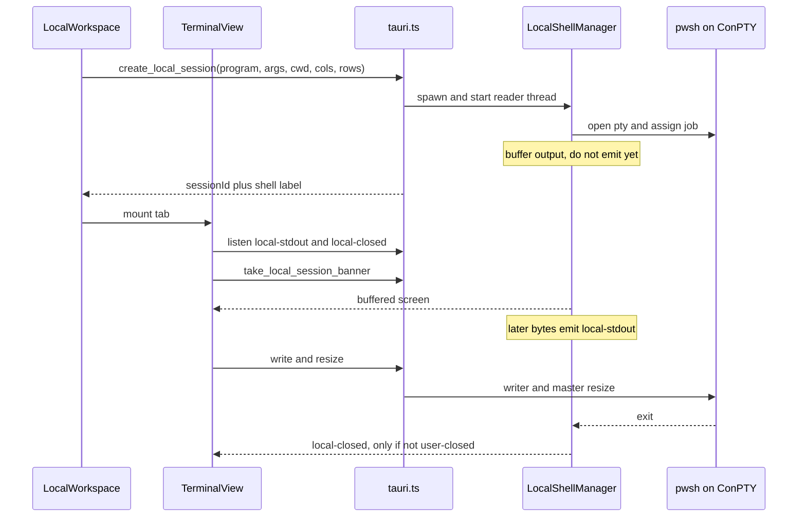
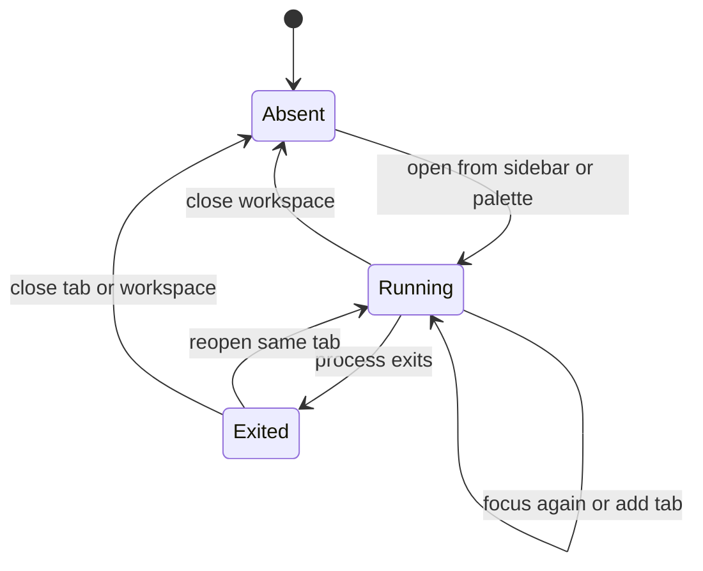
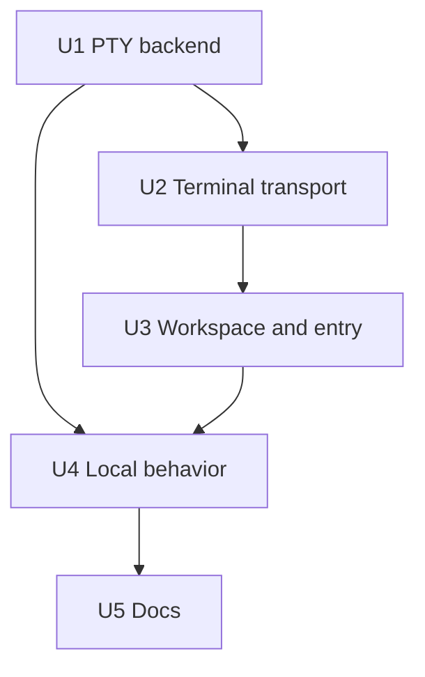
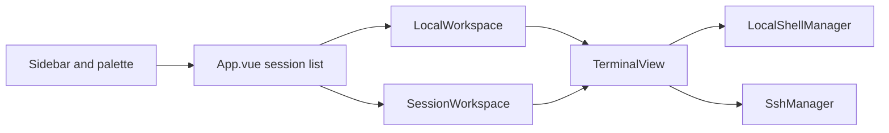

# feat: Add a local PowerShell terminal

## Overview

在现有 xterm.js 终端里增加「本地终端」：用本机 ConPTY / POSIX PTY 启动交互式 shell，Windows 上默认是 PowerShell 7（`pwsh.exe`）。它和 SSH 会话共用渲染、搜索、复制粘贴和外观设置，但不伪装成一台主机，也不嵌入 Windows Terminal。

本计划只交付第一期可用切片。shell 配置档、WSL / Git Bash 预设、本地文件树和 Warp 式 block 明确不做。

---

## Problem Frame

用户在 Windows 上日常用 Windows Terminal 当宿主、PowerShell 7 当 shell，同时又用 SnailSSH 管远程 SSH。两边来回切换时，本地命令（查路径、跑脚本、进目录）离开了同一套标签和外观。

Windows Terminal 是宿主，不是 shell。SnailSSH 要复现的是「本机 pwsh 的交互会话」，不是把 Windows Terminal 嵌进窗口。市场上 Tabby、Electerm、WindTerm、Xshell、SecureCRT 都是自己持有 PTY，再在同一个标签栏里放本地 shell 和 SSH。FinalShell 的「本地化命令输入框」只是远端命令条，本项目已经有 Compose Bar，不能当成同类能力。

没有上游需求文档。产品边界来自上一轮调研结论，并在下面写成可验收的要求。

---

## Requirements Trace

- R1. 桌面端能打开一个本地交互终端，Windows 上优先启动 PowerShell 7，而不是 `cmd`，也不是 Windows Terminal。
- R2. 按键、回显、窗口尺寸变化和进程退出要形成真实双向会话。`vim` 一类全屏程序至少能进入和退出；`Ctrl+C` 交给 shell，不能直接杀掉进程。
- R3. 本地会话不是主机资产：不写 `hosts.json`，不出现在主机列表，不打开 SFTP，不采样远端监控。
- R4. 同一时刻只有一个「本地终端」工作区；再次打开只是聚焦。工作区里可以新开多个标签，每个标签是独立进程。
- R5. 关闭标签、关闭工作区或退出应用时，shell 及其子进程被回收，不残留 `pwsh`。
- R6. 用户可在设置里改可执行文件、参数和工作目录；留空则自动探测。命令行按参数数组传递，不经过 `cmd /c` 或系统 shell 拼接。
- R7. 中文输出在 pwsh 下不乱码。只剩 Windows PowerShell 5.1 或 `cmd` 时允许降级，并在界面上标明实际启动的程序。
- R8. 现有 SSH 终端的连接、重连、SFTP、监控、历史键和危险命令确认行为不变。
- R9. 本地会话可以复用搜索、高亮、复制粘贴、外观和可选会话日志；不把远端 Linux 片段和 `rm -rf` 确认套到本机 PowerShell 上。
- R10. 浏览器预览（非 Tauri）可以打开这块界面，但不得尝试启动本机进程。
- R11. macOS / Linux 用同一套 PTY 命令启动本机 shell（`$SHELL`，再退到 `bash` / `sh`），避免功能只存在于 Windows 编译分支。
- R12. 不设置 `WT_SESSION`，不宣称自己是 Windows Terminal。

---

## Scope Boundaries

- 不嵌入、不自动化 Windows Terminal / wt.exe / ConPty 以外的外部终端窗口。
- 不把本地 shell 做成假 `HostItem`，也不复用 `SshManager`。
- 不做 shell 配置档（pwsh / cmd / WSL / Git Bash 多预设）、Quake 模式、分屏、WebGL 连字、本地文件管理器、OSC 133 shell integration。
- 不新增全局快捷键。`Ctrl+L` 继续透传给 shell 清屏。入口是侧边栏和命令面板。
- 不提升权限，不做 UAC「以管理员运行」。
- 不改 SSH 事件名、首屏扣留协议和输出泵。
- 不引入前端测试框架。前端靠类型检查和下面列出的手工场景验收；自动化测试只加在 Rust。

### Deferred to Follow-Up Work

- shell 配置档、WSL、Git Bash：设置模型已留出「程序 + 参数 + 目录」，后续只加预设，不改 PTY 传输。
- 本地片段库：第一期本地工具栏不显示现在的 Linux 片段。
- 本地文件树，以及用 OSC 7 跟随目录。
- 针对 `Remove-Item -Recurse` 等 PowerShell 危险命令的确认规则。
- 新的全局快捷键。需要先定「终端聚焦时哪些组合键仍然透传」。

---

## Context & Research

### Relevant Code and Patterns

- 远程字节管道已经成型：`src-tauri/src/conn.rs` 申请 PTY，`src-tauri/src/ssh.rs` 用指令通道独占 shell，经 `ssh-stdout-<id>` / `ssh-closed-<id>` 推到前端。`src/components/TerminalView.vue` 先监听、再 `take_ssh_session_banner`，避免首屏丢失。本地会话要抄这个时序，不要抄 SSH 通道本身。
- 前端会话是主机中心的。`src/types/index.ts` 的 `HostSession` 必有 `host`。`src/App.vue` 用 `hostId` 去重。`src/components/SessionWorkspace.vue` 同时挂文件树、SFTP 和 `RemoteMonitorBar`。`src/components/TitleBar.vue` 用 `s.host.group` 画环境色。本地会话若塞进这个结构，会误开 SFTP 和监控。
- 关闭 SSH 标签靠 `tab.id.startsWith('ssh-')`（`src/App.vue`）。本地 id 使用 `local-` 前缀，两边的关闭路径互不调用。
- 命令历史键由 `SessionWorkspace` 算成 `user@host:port`。日志脱敏函数在 `src-tauri/src/ssh.rs` 里是私有的 `redact`。设置 JSON 的结构由前端 `AppSettings` 约束，`src-tauri/src/settings.rs` 只做整块读写。
- 危险命令规则在 `src/utils/commandSafety.ts`，只覆盖 Linux 写法，而且只作用于 Compose Bar，不拦截终端里直接敲的键。
- 新 Tauri 命令必须进 `src-tauri/src/lib.rs` 的 `generate_handler`，前端入口只加在 `src/api/tauri.ts`。耗时命令走 `run_blocking`；常驻读循环不能占着 IPC 线程。
- 仓库没有前端单测运行器。Rust 单测散落在各模块的 `mod tests`。CI（`.github/workflows/ci.yml`）目前只跑前端构建，不跑 `cargo test`。
- `src-tauri/capabilities/default.json` 没有 shell 插件权限。本功能在 Rust 进程内拉起 PTY，不走 `tauri-plugin-shell`，因此不必为了它放开 shell 权限。

### Institutional Learnings

- 没有 `docs/solutions/`。相关约束以根目录 `AGENTS.md` 为准：阻塞 IO 不进 IPC 线程、三步注册命令、改行为时同步 README「已知限制」、不要按 `docs/p0-development-plan.md` 施工。

### External References

- `portable-pty`（WezTerm）提供跨平台 PTY：Windows 走 ConPTY，Unix 走伪终端。`CommandBuilder` 接受程序、参数数组、环境变量和工作目录，默认程序探测不符合「Windows 优先 pwsh」的顺序，不能直接用。
- Tabby / Electerm / WindTerm / Xshell / SecureCRT 都是应用内 PTY，不是嵌入 Windows Terminal。Termius 桌面版也有本地终端，但沙箱安装包会禁用。
- MobaXterm 的本地终端默认是自带的 Cygwin 环境，和「本机 PowerShell 7」不是一条路。
- ConPTY 在 Windows 10 上会改写部分控制序列；Windows 11 更好。这是此类客户端的共同限制，计划接受并写进已知限制，不在第一期做 passthrough 模式分支。

---

## Key Technical Decisions

- 新模块 `src-tauri/src/local_shell.rs` 持有 `LocalShellManager`，作为独立的 Tauri state。不扩展 `SshManager`，避免本地进程被指标采样、SFTP 重置和 SSH 关闭路径误伤。
- 事件使用 `local-stdout-<id>` 和 `local-closed-<id>`。不复用 `ssh-stdout-*`，这样现有监听不会串台。
- 会话 id 形如 `local-<uuid>`。主动关闭不上报 closed；进程自己退出才上报，文案带退出码或启动失败原因。这和 SSH 输出泵「主动关闭不再上报」一致。
- 输出在前端调用取首屏之前积在后端缓冲里，取走后才开始 emit。缓冲有上限，避免 attach 前的洪流占满内存。PTY 没有 SSH 那种「建连时同步读走 banner」的窗口，pwsh 的第一屏提示符很容易落在监听注册之前。
- 读循环放在独立线程，持有 cloned reader。写和 resize 走另一把锁保护的 writer / master。IPC 命令只做入队、校验和回收，不在命令线程里读 PTY。
- 启动参数是程序路径加参数数组。解析顺序在 Windows 上是：设置覆盖、PATH 上的 `pwsh`、`Program Files\PowerShell\7\pwsh.exe`、`powershell.exe`、`cmd.exe`。Unix 上是：设置覆盖、`$SHELL`、`bash`、`sh`。命中结果回给前端显示，不在终端里先执行 `chcp`。
- Windows 不默认设置 `TERM`。Unix 仅在环境里还没有 `TERM` 时设为 `xterm-256color`。各平台都设置 `TERM_PROGRAM=SnailSSH`，且从不设置 `WT_SESSION`。
- 关闭时 Windows 用 Job Object（进程树随 job 结束），Unix 结束整个进程组。只 `TerminateProcess` 父进程不算完成。Job Object 同时是崩溃或被任务管理器结束时的后路：`handleCloseWindow` 今天只确认退出并关闭窗口，不会逐个调用 `close_ssh_session`。
- 前端用可区分联合类型分开 SSH 工作区和本地工作区。本地工作区不渲染 `SessionWorkspace`。`TerminalView` 增加传输种类，SSH 调用点保持原函数。
- 切到本地工作区时不改指标采样的全局目标。`SessionWorkspace` 已在 `isActive` 变为 false 时释放自己持有的目标；本地工作区不调用采样命令。
- 本地历史键固定为 `local:<shell种类>`，例如 `local:pwsh`。不导入远端 `~/.bash_history`。
- 本地工具栏隐藏远端片段、SFTP、复制 SSH 命令和「重新连接」。进程退出后沿用断线条，按钮文案是「重新打开」，复用同一个 xterm 滚动历史。
- 设置缺字段时由前端补默认值，旧的 `settings.json` 仍可加载。后端不解析这几个新字段。

---

## Open Questions

### Resolved During Planning

- 第一期是否做多种 shell 预设：不做。一个自动探测加一个手动覆盖足够覆盖 PowerShell 7。
- 本地工作区能否和 SSH 一样带文件树：不能。文件树绑的是远端 SFTP 会话。
- 要不要新快捷键：不要。`Ctrl+L` 必须继续清屏；终端聚焦时全局键还会透传。侧边栏和 `Ctrl+K` 面板足够。
- 浏览器预览是否模拟一个假 shell：不模拟。只显示一行说明，避免再维护一套假 PowerShell。

### Deferred to Implementation

- `portable-pty` 是否已经把 ConPTY 输出转成 UTF-8，还是要在读线程里从 UTF-16 转。验收标准是 pwsh 打出的中文不乱码；具体转换点看到 crate 行为再定。
- Job Object 要挂在 `portable-pty` 返回的子进程上，还是要在 spawn 前包一层 Windows API。计划只要求「关闭后子进程不残留」，不预定函数名。
- `redact` 是原样改成 `pub(crate)`，还是抽到一个小模块。策略不能分叉：本地日志和 SSH 日志使用同一套脱敏。
- Windows 10 上个别全屏程序的残影，是否值得写进 README 的具体例子。以实际手工验收为准，不预写未复现的序列。

---

## High-Level Technical Design

> *This illustrates the intended approach and is directional guidance for review, not implementation specification. The implementing agent should treat it as context, not code to reproduce.*

本地工作区的生命周期：

---

## Implementation Units

- [x] U1. **Local PTY session backend**

**Goal:** 提供与 SSH 终端平行的本地会话命令：创建、写入、改尺寸、取首屏、关闭，以及进程退出通知。

**Requirements:** R1, R2, R5, R6, R7, R11, R12

**Dependencies:** None

**Files:**
- Create: `src-tauri/src/local_shell.rs`
- Modify: `src-tauri/src/lib.rs`
- Modify: `src-tauri/src/ssh.rs`（仅当把现有 `redact` 暴露给本地日志复用时）
- Modify: `src-tauri/Cargo.toml`
- Test: `src-tauri/src/local_shell.rs`

**Approach:**
- 依赖使用 `portable-pty`。用自己的解析函数决定程序，不用 crate 的默认程序。
- 创建参数：可选程序、参数数组、可选工作目录、列、行。程序和目录为空表示自动。返回会话 id 和实际启动的程序说明（例如 `PowerShell 7` 或 `Windows PowerShell`）。
- 校验失败直接返回错误，不要启动进程：程序解析不到、路径不是可执行文件、参数或路径含空字节、工作目录不存在或不是目录。不要把整段设置字符串交给 `cmd.exe`。
- 读线程在 `take` 之前只进内存缓冲，缓冲必须有上限；超出后丢掉最旧的数据并留下截断标记，具体上限实现时再定。`take` 之后按 UTF-8 边界切块再 emit，避免中文被截断。进程若在 `take` 之前已经退出，把原因留在缓冲结果里，并在 `take` 之后补一次 closed，避免前端还没监听就丢事件。
- 用户调用关闭：停读、结束进程树、不发 closed。重复关闭同一个 id 视为成功。
- 写入一个已退出的会话返回明确错误，前端可以显示一次「写入失败」。
- 会话日志沿用现有脱敏、有界 channel 和「写不动就丢」的策略。目录用 `logs/local/`，不要写进某台主机的目录。日志命令可以放在本模块，不必绕回 `SshManager`。
- Windows 创建后立刻把子进程放进 Job Object。Unix 关闭时结束进程组。环境变量按 Key Technical Decisions 设置。

**Execution note:** 先写解析顺序、参数校验和「未 attach 前只缓冲」的失败测试，再接真实 PTY。真实 pwsh 往返测试在本机没有 `pwsh` 时跳过，不能让无 pwsh 的环境编译失败。

**Patterns to follow:**
- `src-tauri/src/ssh.rs` 的指令所有权、主动关闭不发 closed、首屏与实时输出的顺序
- `src-tauri/src/lib.rs` 的 `run_blocking` 和 `generate_handler`

**Test scenarios:**
- Happy path: 给定一个假想的可执行路径解析器，PATH 上有 `pwsh` 时选中它，并标成 PowerShell 7。
- Happy path: PATH 没有 `pwsh`、约定目录有 PowerShell 7 可执行文件时，选中该路径。
- Edge case: PATH 和约定目录都没有 pwsh 时，Windows 选 `powershell.exe`；再没有才选 `cmd.exe`。Unix 在 `$SHELL` 不可执行时落到 `bash`，再落到 `sh`。
- Edge case: 用户指定的程序优先于自动探测，即使 PATH 上有别的 pwsh。
- Error path: 程序名含空字节、工作目录是一个文件、自动探测三个候选都不存在，创建失败且没有残留会话 id。
- Error path: 对未知 id 写入、改尺寸、取首屏，返回会话不存在；关闭未知 id 不报错。
- Edge case: attach 之前写入的输出留在缓冲；attach 时一次性取回，之后的新输出不再出现在第二次 take 里。
- Edge case: 进程在 attach 前退出，take 的结果仍包含退出前的输出，并且之后能观察到一次关闭原因。
- Integration: 本机存在 `pwsh` 时，PTY 中执行输出固定标记和「中文」两个字符，读回的字节是合法 UTF-8 且包含两者。关闭后该进程及其直接子进程不再存在。没有 `pwsh` 时这条跳过。

**Verification:**
- `cargo test` 中本模块测试通过；无 pwsh 时集成往返被跳过而不是失败。
- `cargo check` 通过。新命令出现在 `generate_handler` 中。
- 不修改 SSH 命令的参数和事件名。

---

- [x] U2. **Terminal transport switch**

**Goal:** `TerminalView` 能把同一个 xterm 接到 SSH 或本地 PTY，SSH 路径的函数和事件保持原样。

**Requirements:** R2, R8, R10

**Dependencies:** U1

**Files:**
- Modify: `src/api/tauri.ts`
- Modify: `src/types/index.ts`
- Modify: `src/components/TerminalView.vue`
- Test: 无自动化测试文件。本仓库没有前端测试运行器；下列场景用手工验收。

**Approach:**
- 在 `src/api/tauri.ts` 增加本地会话的创建、写、resize、关闭、取首屏、开关日志和两个事件监听。非 Tauri 环境这些函数不调用 `invoke`。
- 给终端标签一个传输种类，默认 SSH。本地标签才走本地 API。
- 绑定顺序与 SSH 相同：先注册 stdout 和 closed，再取首屏，再放行期间积下的块。
- 本地会话不调用 `announceLastLoginIfMissing`，不调用远端 `exec` 去补 Last login。
- 浏览器预览打开本地标签时，往 xterm 写一行说明「预览模式不会启动本机 PowerShell」，不注册后端监听。

**Patterns to follow:**
- `TerminalView.vue` 里 `bindSessionEvents` 的首屏顺序
- `src/api/tauri.ts` 里 `isTauri()` 降级

**Test scenarios:**
- Happy path: Tauri 下本地标签的按键调用本地写入，SSH 标签仍调用 `write_ssh_session`。
- Happy path: 本地首屏在监听注册之后才画到 xterm，提示符不落在监听窗口外面。
- Edge case: 本地进程退出后面板进入断线状态，文案不是「重新连接」的 SSH 措辞。
- Error path: 本地写入失败只提示一次，不把后续每个按键都刷成错误。
- Integration: 一个 SSH 标签和一个本地标签同时存在时，两边的输出事件不会写进对方的 xterm。
- Edge case: 非 Tauri 打开本地标签不抛 `invoke` 错误，只显示预览说明。

**Verification:**
- `pnpm build` 的类型检查通过。
- 手工确认现有 SSH 会话仍能输入、重连和保留滚动历史。

---

- [x] U3. **Local workspace and entry points**

**Goal:** 从侧边栏或命令面板打开唯一的本地工作区，顶栏能切换和关闭，且不会碰到主机字段。

**Requirements:** R3, R4, R8, R10

**Dependencies:** U2

**Files:**
- Create: `src/components/LocalWorkspace.vue`
- Modify: `src/types/index.ts`
- Modify: `src/App.vue`
- Modify: `src/components/TitleBar.vue`
- Modify: `src/components/Sidebar.vue`
- Modify: `src/components/CommandPalette.vue`
- Modify: `src/composables/useAppSettings.ts`
- Modify: `src/components/SettingsModal.vue`
- Test: 无自动化测试文件。场景手工验收。

**Approach:**
- `App.vue` 的会话列表改成 SSH 工作区与本地工作区的联合类型。只有 SSH 分支继续渲染 `SessionWorkspace`。本地分支渲染新的 `LocalWorkspace`，里面只有 `TerminalView`。
- 顶栏对本地项不读 `host.group`。用固定的终端标记和标题「本地终端」，不要环境色点，也不要 SFTP 角标。
- 侧边栏「SSH 在线」计数只算 SSH 工作区。新增「本地终端」按钮；已存在则聚焦，不存在则创建。
- 命令面板系统动作增加「打开本地终端」。搜索「本地」或「PowerShell」时能滤到。不绑定新快捷键。
- 再次点击不新建第二个工作区。工作区内「新终端」再创建一个 `local-` 进程标签。
- 关闭工作区时关闭其中全部本地进程。`handleCloseWindow` 不会逐个关闭 SSH。本地进程要在确认退出之后、调用窗口 `close()` 之前显式关闭，并等日志槽释放。不要借这次改动去补 SSH 的关闭逻辑。
- 创建命令已经成功、但界面没能挂上工作区时，立刻关闭刚返回的会话 id。
- 命令面板的新动作接到现有的 `handlePaletteAction`，不要另做一套面板状态。
- 设置增加本地 shell 段：程序、参数、工作目录，均可空。空程序表示自动，空目录表示用户主目录。前端按现有设置归一化补默认值。打开会话时把这三项传给创建命令。设置页写明当前默认是 PowerShell 7，以及留空时的探测顺序。
- 已打开的本地进程不因设置保存而重启。下一次新标签或重新打开才使用新设置。

**Patterns to follow:**
- `src/App.vue` 的 `handleConnectHost` 去重和 `handleCloseSession`
- `src/composables/useAppSettings.ts` 对缺字段补默认值的方式
- `src/components/CommandPalette.vue` 现有的系统动作项

**Test scenarios:**
- Happy path: 侧边栏打开后顶栏出现「本地终端」，工作区没有文件树和底部监控条。
- Happy path: 再次从侧边栏或命令面板打开，仍是同一个工作区，只是被聚焦。
- Happy path: 工作区内新开标签得到新的 `local-` id，关掉其中一个不关掉整个工作区；关掉最后一个标签则关掉工作区。
- Edge case: 已有 SSH 会话时打开本地终端，SSH 会话仍在顶栏，SFTP 和监控不受影响。侧边栏在线数不因为本地工作区加一。
- Edge case: 旧 `settings.json` 没有本地 shell 字段时，应用仍能启动，并按自动探测打开。
- Error path: 创建命令返回「找不到 PowerShell」时，不留下一个空白且无法关闭的工作区，并用 toast 显示后端原因。
- Integration: 确认退出后、窗口消失前，本地 `pwsh` 已经结束。从 SSH 工作区切到本地工作区后，远端指标采样仍由原来的「切走即释放」停掉，本地 id 不会被设成采样目标。非 Tauri 预览能打开界面且不请求后端。

**Verification:**
- `pnpm build` 通过。
- 手工走通打开、聚焦、多标签、关闭和设置留空。

---

- [x] U4. **Local session behavior**

**Goal:** 本地终端复用通用终端能力，同时关掉只对远端 Linux 有意义的动作。

**Requirements:** R5, R8, R9

**Dependencies:** U1, U2, U3

**Files:**
- Modify: `src/components/TerminalView.vue`
- Modify: `src/components/LocalWorkspace.vue`
- Modify: `src/App.vue`
- Test: 无自动化测试文件。场景手工验收。

**Approach:**
- 历史键使用 `local:` 加实际 shell 种类。补全可以继续用本机历史；不调用远端 bash history 导入。
- 本地标签不显示远端片段按钮，不把 `docker ps` / `systemctl` 片段发进 pwsh。Compose Bar 若仍保留，不跑 `detectDangerousCommand`，也不因分组高风险再弹确认。
- 右键和标签菜单去掉「重新连接」「复制登录信息」「复制 SSH 命令」「打开 SFTP」。进程退出后的主按钮调用与重连相同的「换后端 id、保留 uiId 和滚动历史」路径，但文案是「重新打开」，且创建的是本地会话。
- 可选会话日志继续用现有 REC 开关和自动记忆。本地文件进入 `logs/local/`。打开日志目录仍限制在应用数据目录内。
- `Ctrl+L`、`Ctrl+C` 保持透传。复制粘贴、查找、高亮和外观继续生效。
- 不根据 OSC 7 去改任何文件树。可以忽略这些序列。

**Patterns to follow:**
- `TerminalView.vue` 重连时按 `uiId` 迁移 xterm，而不是销毁实例
- `src/utils/commandSafety.ts` 只在远端 Compose Bar 使用

**Test scenarios:**
- Happy path: 本地输入一条命令后，历史记在 `local:pwsh`（或实际种类）下，SSH 主机的历史列表里看不到它。
- Happy path: 本地标签没有 `systemctl status nginx` 片段按钮；SSH 标签的片段按钮仍在。
- Edge case: 在本地 Compose Bar 输入 `rm -rf /` 直接发送，不弹高风险确认。同一文本在高风险分组的 SSH 会话里仍弹确认。
- Happy path: 退出 pwsh 后再点「重新打开」，旧输出还在，中间有重新打开的分隔，新进程能继续输入。
- Edge case: 开启 REC 后，本地日志出现在 `logs/local/`，内容经过与 SSH 相同的脱敏；关闭标签后不再继续写入该文件。
- Integration: 本地标签里按 `Ctrl+L` 清的是 shell 屏幕，不会被应用当成别的快捷键吃掉。

**Verification:**
- 手工对比一个 SSH 标签和一个本地标签，确认 R8 和 R9 同时成立。
- `pnpm build` 通过。

---

- [x] U5. **Document the limitation and the default shell**

**Goal:** README 与设置文案和实际行为一致，避免把本地终端写成嵌入 Windows Terminal 或完整替代品。

**Requirements:** R1, R7, R12

**Dependencies:** U4

**Files:**
- Modify: `README.md`
- Modify: `README.en.md`
- Test: 无。文档与设置文案对照实现核对。

**Approach:**
- 在功能说明里写明：本地终端是本机 PTY，Windows 默认 PowerShell 7，设置可改程序和目录。
- 已知限制写明：不嵌入 Windows Terminal；不设置 `WT_SESSION`；ConPTY 在 Windows 10 上可能改写个别控制序列；只有 `cmd` 时代码页可能不是 UTF-8；关闭会话会结束该标签的进程树；本地片段和 PowerShell 危险命令确认不在本版。
- 英文 README 用同样的边界，不增加没有实测的性能数字。

**Test expectation:** none -- 文档对照，不新增行为。

**Verification:**
- README 的描述能被 U1 到 U4 的行为覆盖，没有「嵌入 Windows Terminal」或「支持 WSL 预设」这类尚未实现的句子。

---

## System-Wide Impact

- **Interaction graph:** 新入口在侧边栏、命令面板和顶栏。`SessionWorkspace`、文件树、传输抽屉和主机保存路径不订阅本地会话。指标采样目标仍然只由 SSH 工作区设置。
- **Error propagation:** 创建失败停在 toast，不插入会话。运行中的写入失败只提示一次。进程退出走 closed 事件，进入可重新打开状态。主动关闭吞掉 closed。
- **State lifecycle risks:** 首屏缓冲只能取一次，并且有上限。关闭必须释放 job、读线程和日志 channel。窗口关闭函数不关闭 SSH，进程退出只是顺带拆掉 russh 连接；ConPTY 子进程没有这个保证。U3 在窗口 `close()` 之前显式关闭本地会话，Job Object 覆盖未经这个函数的进程死亡。创建成功但界面挂载失败时必须补一次关闭。切走 SSH 工作区时，现有 `isActive` 监听会释放指标目标；本地工作区不得再写这个全局目标。
- **API surface parity:** 本地命令是新的 IPC，不是 SSH 命令的可选参数。浏览器预览两个传输都要有降级。
- **Integration coverage:** 自动化测试覆盖解析、校验和缓冲。PTY 往返、进程树回收、中文和双会话隔离靠 Rust 可选集成测试加手工场景。CI 目前不跑 Rust 测试，完成标准仍包括本地 `cargo test` 和 `cargo check`。
- **Unchanged invariants:** `hosts.json`、SSH 事件名、`user@host:port` 历史、高风险分组确认、SFTP 和远端监控的触发条件不变。`capabilities/default.json` 不新增 shell 权限。

---

## Alternative Approaches Considered

- 嵌入 Windows Terminal：没有稳定的可嵌入控件。用户要的是 pwsh 会话，宿主可以是 SnailSSH 自己的 xterm。
- 造一台假主机走现有 SSH 工作区：会写入或模拟主机资产，并带上文件树、监控和 Linux 片段。和 R3、R8 冲突。
- 把本地进程放进 `SshManager`：关闭、采样和 SFTP 重置都按 SSH 连接编写，误伤面大。
- 用 `tauri-plugin-shell` 或在前端拉起进程：插件不是交互式 PTY，前端也没有 Node PTY。后端 `portable-pty` 和现有输出泵同侧。
- 像 MobaXterm 那样内置 Cygwin：体积和默认 shell 都不是本项目要的。

---

## Phased Delivery

### Phase 1

本计划的 U1 到 U5。交付一个可输入的本地 PowerShell 工作区。

### Phase 2

shell 预设、本地片段、PowerShell 危险命令规则。只有在第一期的传输和关闭路径稳定之后再做。

### Phase 3

本地文件树和 shell integration。那会重新引入工作区布局，不属于这一张计划。

---

## Risks & Dependencies

| Risk | Likelihood | Impact | Mitigation |
|------|-----------|--------|------------|
| ConPTY 在 Windows 10 改写控制序列，全屏程序残影 | Med | Med | 第一期接受并写入已知限制。不伪造 `WT_SESSION` 去打开另一套未实现的协议。 |
| 只结束父进程，pwsh 拉起的子进程残留 | Med | High | 完成标准包含进程树回收。Windows 用 Job Object，Unix 用进程组。确认退出后先显式关闭本地会话；Job Object 覆盖崩溃。 |
| PATH 上的 `pwsh` 被同名程序抢先 | Low | Med | 与 Windows Terminal 一样接受用户 PATH。设置里的绝对路径优先。界面显示实际启动的程序，便于发现抢占。 |
| attach 前输出把缓冲撑大 | Low | Med | 缓冲有上限，超出丢弃最旧数据并留下截断标记。 |
| 中文 Windows 代码页导致乱码 | Med | High | 验收使用 pwsh 输出「中文」。不在用户配置文件里注入 `chcp`。`cmd` 降级单独写明限制。 |
| 设置里的程序字段被当成 shell 命令注入 | Low | High | 只接受程序路径和参数数组，拒绝空字节，不调用 `cmd /c`。 |
| 本地会话误进 SSH 关闭、采样或历史 | Med | High | 独立 manager、独立事件名、`local-` id，以及联合类型。U2/U4 有对照场景。 |
| `portable-pty` 的 Windows 行为与文档不完全一致 | Med | Med | UTF-8 和 job 的具体接法留到实现时按 crate 行为决定，但验收标准不变。 |

---

## Documentation Plan

- `README.md` 与 `README.en.md` 由 U5 更新功能说明和已知限制。
- 设置页文案在 U3 写清探测顺序和「已打开的会话不热切换」。
- 不更新 `docs/p0-development-plan.md`。

---

## Operational / Rollout Notes

- 没有功能开关。设置留空即自动探测，旧配置文件无需迁移。
- 进程以当前用户身份运行，不请求管理员权限。
- 会话日志仍是明文，沿用现有脱敏限制。本地日志多了一个 `logs/local/` 目录。
- 验证命令沿用项目约定：`pnpm build`，以及 `cargo check` 和 `cargo test`。CI 未跑 Rust 测试这一点要在完成说明里如实写，不能写成 CI 已覆盖。

---

## Sources & References

- Related code: `src-tauri/src/ssh.rs`, `src-tauri/src/conn.rs`, `src/components/TerminalView.vue`, `src/components/SessionWorkspace.vue`, `src/App.vue`
- External docs: [portable-pty](https://docs.rs/portable-pty/latest/portable_pty/), [Electerm local connection](https://github.com/electerm/electerm/wiki/Command-line-usage), [Termius local terminal](https://docs.termius.com/help-center/troubleshooting/i-cant-find-the-local-terminal-option-in-the-desktop-app), [FinalShell feature list](https://www.hostbuf.com/t/988.html)
