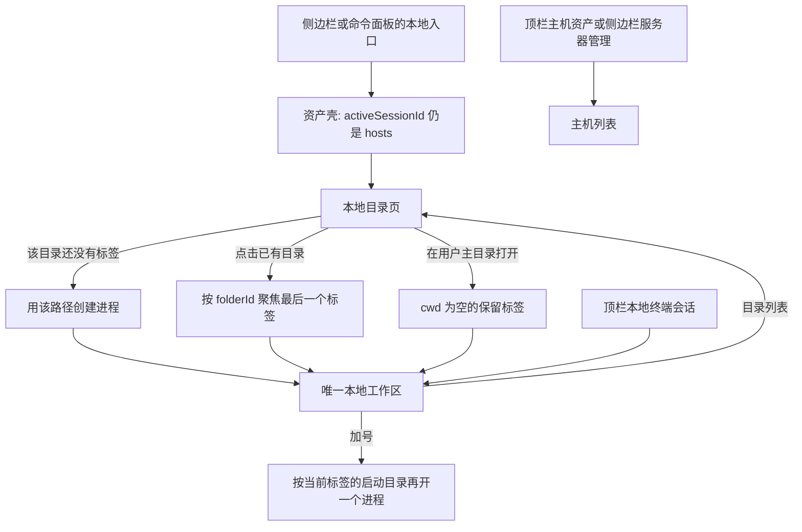

# feat: Open local terminals from a saved folder list

## Overview

侧边栏「本地终端」和命令面板里的同名入口，不再立刻在用户主目录启动 shell。它们改为进入一个本地目录列表。列表可以添加、改名、改路径和删除目录。点击一条目录时，仍只有一个本地工作区：该目录已有标签就聚焦，没有才按该路径新开一个标签。

设置里的程序和参数继续作用于之后新开的本地标签。工作目录改由目录列表决定，不再由「终端外观 → 本地终端」里的单一路径决定。

---

## Problem Frame

现在 `src/App.vue` 的 `openLocalWorkspace()` 在没有本地工作区时立刻调用 `createLocalSessionApi()`。工作目录来自 `settings.localShell.cwd`，留空则由 `src-tauri/src/local_shell.rs` 的 `resolve_cwd` 落到用户主目录。已经有工作区时，再次点击只聚焦，不会问目录。

用户要先看到一份可维护的本地目录，再决定在哪个目录开命令行。交互上对齐主机资产：先列表，后进入会话。已确认的组织方式不是「每个目录一个顶栏会话」，而是继续保持唯一本地工作区，用标签区分目录。

没有上游需求文档。上一份本地终端计划 `docs/plans/2026-10-30-001-feat-local-shell-plan.md` 已完成，本计划只改它的入口和工作目录来源，不重做 PTY。

---

## Requirements Trace

- R1. 侧边栏「本地终端」和命令面板「打开本地终端」进入目录列表，不因为这次点击启动 shell。
- R2. 目录列表可以添加、重命名、修改路径和删除。添加时可以用系统目录选择器，也可以粘贴路径。
- R3. 点击一条目录：该目录已有标签则聚焦；没有则在唯一本地工作区里新开标签，进程的工作目录就是这条路径。
- R4. 同一时刻仍然只有一个本地工作区。它不进 `hosts.json`，不开 SFTP，不采样远端监控。
- R5. 工作区里的「新开标签」沿用当前标签的启动目录再开一个进程，而不是回到设置里的旧默认目录，也不是回到主目录。
- R6. 重连使用这个标签对应的目录。目录仍在列表里且路径被改过时，用列表上的新路径；目录已从列表删除时，用标签打开时记下的路径。
- R7. 目录清单存在 `settings.json`，缺字段时补空列表。若旧配置只在 `localShell.cwd` 写过一个非空路径，且还没有目录字段，首次读取把它收成一条目录，然后不再用这个字段启动终端。
- R8. 路径不存在、不是目录，或 shell 启动失败时，用现有 toast 显示后端原因，不留下空白标签，并留在目录列表。
- R9. 浏览器预览可以维护列表和打开预览标签，但不启动本机进程。
- R10. 已打开的 SSH 会话、SFTP、主机列表和本地 PTY 的关闭回收行为不变。
- R11. 用户主目录仍可显式打开，但不再是点击「本地终端」的默认结果。

---

## Scope Boundaries

- 不做每个目录一个顶栏会话，不把本地目录写成 `HostItem`。
- 不做本地文件树、目录分组、收藏排序拖拽，也不做「列表里再开一个同目录标签」的第二按钮。同目录的第二个进程只用终端标签上的加号。
- 不改 shell 探测顺序，不新增 WSL / Git Bash 预设，不给每个目录单独配置程序和参数。
- 不在添加时探测路径是否存在，也不做符号链接或 8.3 短名的真实路径归一。重复判断只做字符串规范化。
- 不跟踪本机 shell 里后续 `cd` 后的当前位置。标签绑定的是启动目录。
- 不删除已经在跑的进程来响应用户对列表的改名、改路径或删除。
- 不引入前端测试运行器。前端沿用类型检查和手工场景；本功能不改 Rust 的 PTY 实现，因此不新增 Rust 测试，除非实现时发现必须改 `resolve_cwd`。

### Deferred to Follow-Up Work

- 添加前的存在性检查，以及用系统真实路径合并符号链接。
- 每个目录单独的 shell 程序、参数或管理员身份。
- 本地文件树。

---

## Context & Research

### Relevant Code and Patterns

- 入口在 `src/components/Sidebar.vue` 的「本地终端」按钮，以及 `src/components/CommandPalette.vue` 的 `open-local-terminal`。两者都进 `src/App.vue` 的 `openLocalWorkspace()`。
- 资产页只在 `activeSessionId === 'hosts'` 时挂出。侧边栏和 `src/components/HostManager.vue` 在这个壳里。进入 SSH 或本地工作区后侧边栏会卸掉，顶栏负责回来。本地目录列表必须留在这个资产壳里，不能做成第三种会卸掉侧边栏的会话。
- 顶栏固定项「主机资产」在 `src/components/TitleBar.vue`，点击把 `activeSessionId` 设回 `hosts`。本地工作区是 `sessions` 里 `kind === 'local'` 的那一项，标题固定「本地终端」。
- 目录选择已经有 `src/api/tauri.ts` 的 `pickDirectory()`，底层是 Tauri dialog 的 `directory: true`。浏览器预览返回 `null`。
- 设置整块读写。前端 `src/composables/useAppSettings.ts` 的 `normalizeSettings` / `defaultSettings` / `applySettings` 补字段；`src-tauri/src/settings.rs` 不解释结构。书签数组是最接近的清单形状，但那些 path 是远端 SFTP 路径，不能复用。
- 启动目录已经是 `CreateLocalSessionRequest.cwd`。空值走主目录；文件或缺失路径返回「工作目录不是目录 / 工作目录不存在」。本地终端不消费 OSC 7，`src/components/TerminalView.vue` 对 `transport === 'local'` 直接忽略目录转义，所以 `tab.cwd` 不会被 `cd` 改写。
- 关闭、重连和加标签都在 `src/App.vue` 的 `handleCloseLocalTab`、`handleAddLocalTab`、`handleReconnectLocalTab`。加号和「复制标签」在 `src/components/LocalWorkspace.vue` 里都发 `add-terminal-tab`。
- 删除主机用 `confirmDialog`。重命名终端标签用 `promptDialog`。目录删除和改名沿用这两个，不用原生 `confirm` / `prompt`。
- 仓库没有前端测试运行器。`src-tauri/src/local_shell.rs` 已覆盖空目录、文件路径和不存在路径。

### Institutional Learnings

- `docs/solutions/` 不存在。可执行约束来自根目录 `AGENTS.md`：本地会话不是主机；设置缺字段由前端补默认；改既有文件前备份到 `backups/<任务名>/`。

### External References

- 未做外部调研。目录选择、设置归一化和本地 PTY 的 cwd 参数在仓库里已有直接实现。

---

## Key Technical Decisions

- 目录列表是资产壳里的另一页，不是新的 `WorkspaceSession`。`activeSessionId` 仍用 `hosts` 表示「侧边栏还在」。另用一个页状态区分主机列表和本地目录列表。这样 SSH 会话和唯一本地工作区都还能用现有的 `v-show` 留在后台。
- 侧边栏只在资产壳里。会话进行中要回到目录列表，走命令面板的列表入口，或者走本地终端标签条上的返回按钮。这两条都先回到资产壳再显示目录页，不聚焦已有本地工作区，也不创建进程。
- 点顶栏「主机资产」或侧边栏「服务器管理」时，页状态回到主机列表。这两个入口现在不经过同一个函数，实现时都要改。避免用户从终端回来却还停在目录页。
- 点顶栏已有的「本地终端」会话仍只聚焦工作区。从工作区返回列表靠终端标签条上的一个「目录列表」按钮，因为这时侧边栏不可见。
- 标签用稳定的 `folderId` 对应目录，而不是用标题字符串。列表点击按 `folderId` 找最后一个匹配标签并聚焦。找不到才创建。
- 启动路径在创建进程时写入标签。重连时若该 `folderId` 还在清单里，用清单上的当前路径；否则用标签上的快照。这样改错路径后重连能用新路径，删除目录也不会让已开标签失去重连目标。
- 加号和复制标签都读取当前标签的启动目录再创建进程，并带上同一个 `folderId`。没有当前标签时不猜目录。
- 显式「在用户主目录打开」使用保留 id，不写入清单。传给后端的 cwd 为空，沿用现有主目录解析。再次点击只聚焦这个保留标签。
- 清单字段放在 `AppSettings` 的新数组里，元素只有 id、显示名和路径。不进 `hosts.json`。上限 100 条。
- 路径重复只比较规范化后的字符串：去掉首尾空白和末尾分隔符，把 `/` 与 `\` 看成同一种分隔符；Windows 上大小写不敏感，其他系统敏感。根路径保留。不做 `canonicalize`。
- 显示名留空时用路径最后一段；根路径用盘符或 `/`。用户后来改的是清单显示名。终端标签标题在创建时抄一份，之后只受标签重命名影响，不随清单改名回写。标签副标题继续显示实际 shell 名称，完整路径放在提示里。
- 设置页去掉「工作目录」输入框。程序和参数保留。旧的非空 `localShell.cwd` 只在目录字段本身不存在时迁移一次，迁移后的内存值清空，避免每次启动再插入一条。
- 添加、修改、删除目录后立即沿用现有 `flushSettings`，不只靠 400ms 防抖。这些是离散编辑，不是滑块。
- 浏览器预览没有目录选择器结果时，只提供粘贴路径。打开目录只创建预览标签。

---

## Open Questions

### Resolved During Planning

- 一个工作区还是每个目录一个顶栏会话：一个工作区，标签对应目录。用户已确认。
- 点击「本地终端」是否还要直接打开主目录：不要。主目录只保留成列表上的显式动作。
- 同一目录再次点击是新开还是聚焦：聚焦已有标签。第二个进程走终端加号。
- 旧的设置工作目录怎么处理：收成第一条目录，不再作为隐式启动目录。

### Deferred to Implementation

- 目录显示名与 Windows 盘符、UNC 路径的最后一段具体截取细节。原则是空名不能落成空标题，根路径不能截成空字符串。
- 终端标签条上「目录列表」按钮的最终图标和文案宽度。窄窗口时可以只留图标，但必须有中文提示。

---

## High-Level Technical Design

> *This illustrates the intended approach and is directional guidance for review, not implementation specification. The implementing agent should treat it as context, not code to reproduce.*

清单项只表达「下次打开时用哪条路径」。运行中的进程不因清单变化而换目录。

---

## Implementation Units

- [x] U1. **Persist the local folder catalog**

**Goal:** 设置能保存本地目录清单，旧的单一工作目录会被安全收进来，重复路径有稳定的比较规则。

**Requirements:** R7

**Dependencies:** None

**Files:**
- Modify: `src/types/index.ts`
- Modify: `src/composables/useAppSettings.ts`
- Create: `src/utils/localFolder.ts`
- Test: 无自动化测试文件。仓库没有前端测试运行器；本单元不改 Rust。

**Approach:**
- 在应用设置类型和默认值里增加目录数组。`normalizeSettings` 丢弃缺 id、缺路径或空路径的项，给缺 id 的项补 id，空显示名按决策补最后一段，并按规范化路径去重，保留先出现的一条。超过 100 条时截断。
- 三个写回点都要带上这个数组：`defaultSettings`、`normalizeSettings`、`applySettings`。漏掉 `applySettings` 会导致读盘后字段丢失。
- 迁移只看原始 JSON 有没有目录字段。没有字段且 `localShell.cwd` 去空白后非空时，插入一条。字段已经是数组时，即使用户把它清空，也不再从 cwd 迁移。
- 规范化后的 `localShell.cwd` 固定为空。程序和参数的归一化不变。
- 路径比较放在独立纯函数里，供添加、迁移和点击聚焦共用，避免两处规则漂移。

**Patterns to follow:**
- `src/composables/useAppSettings.ts` 里书签和 `localShell` 的归一化。
- `src/types/index.ts` 的 `BookmarkItem` 只作字段形态参考，语义不要混用。

**Test scenarios:**
- Happy path: 原始设置没有目录字段，`localShell.cwd` 为 `D:\work`。归一化后清单有一条路径 `D:\work`，内存里的 cwd 为空。
- Happy path: 原始设置已有目录数组。即使 cwd 仍是另一个路径，也不再插入。
- Edge case: 同一路径以 `D:\work`、`D:/work/` 和 `d:\work` 出现在 Windows 比较中，只保留第一条。`D:\work` 与 `D:\work2` 不是重复。
- Edge case: 非 Windows 比较里 `~/Work` 与 `~/work` 不合并。空路径、空白路径和非对象项被丢弃。
- Edge case: 第 101 条被截掉。空显示名变成路径最后一段。
- Error path: 原始设置不是对象，或目录字段类型错误。结果是空清单加默认 shell，不抛异常。

**Verification:**
- 类型检查能通过，旧的 `settings.json` 在缺字段时仍能打开应用。
- 读入含旧 cwd 的设置后，界面不再把该 cwd 当作所有新标签的隐式目录。

---

- [x] U2. **Show the folder list inside the asset shell**

**Goal:** 用户点「本地终端」后看到可增删改的目录列表，而不是一个已经启动的 shell。

**Requirements:** R1, R2, R9, R11

**Dependencies:** U1

**Files:**
- Create: `src/components/LocalFolderManager.vue`
- Modify: `src/App.vue`
- Modify: `src/components/Sidebar.vue`
- Test: 无自动化测试文件。手工场景如下。

**Approach:**
- 资产壳继续由「当前不是某个会话」控制。壳内主区域按页状态在 `HostManager` 和目录列表之间切换。
- 侧边栏「本地终端」改为切换页，并带上选中态。它的提示改成「打开本地目录列表」。主机分组过滤只影响主机列表。
- 顶栏选择「主机资产」和侧边栏切到「服务器管理」都把页状态设回主机列表。只改其中一条路径不够，因为它们现在分别写在会话选择和侧边栏切换里。
- 列表顶栏有搜索、添加和「在用户主目录打开」。搜索匹配显示名或原始路径，空列表和无结果要分开文案。
- 每一行显示显示名和路径，点击行或明确的打开动作都发出「打开此目录」。编辑可以改显示名和路径；路径可以用选择器重新选取，也可以直接改文本。删除先确认。确认文案说明已打开的终端不会关闭。
- 添加优先调用已有目录选择器。取消选择器不插入。选择器不可用或用户要粘贴时，用现有文本输入弹窗。规范化后与已有项重复则 toast 并不插入。达到 100 条时 toast 并不插入。
- 成功的添加、修改、删除立刻 `flushSettings`。
- 浏览器预览下选择器没有返回值，添加只走文本路径。

**Patterns to follow:**
- `src/components/HostManager.vue` 的顶栏、搜索和空状态，但不要复制 CPU、延迟、SFTP 或导入导出。
- `src/components/SettingsModal.vue` 的书签行内编辑只作密度参考。目录列表是主页面，不是设置页里的小表。
- `src/App.vue` 的 `handleDeleteHost` 使用 `confirmDialog` 的方式。

**Test scenarios:**
- Happy path: 在主机资产页点击「本地终端」，主区域换成目录列表，侧边栏仍在，没有新的本地进程标签。
- Happy path: 选择器返回 `D:\repo`。列表出现该路径，显示名默认是最后一段，重启应用后仍在。
- Happy path: 搜索 `repo` 能命中显示名或路径；清空搜索恢复全部。
- Edge case: 选择器取消，列表不变。粘贴与已有项规范化后相同的路径，出现重复提示且不新增。
- Edge case: 已有 100 条时再添加，被拒绝。删除一条后再添加，可以成功。
- Edge case: 把显示名改成空白后保存，界面仍显示路径最后一段，不出现空标题。
- Error path: 浏览器预览打开列表时不调用本机 shell。预览里用文本添加一条路径，只改列表。
- Integration: 在目录页点顶栏「主机资产」或侧边栏「服务器管理」，主区域回到主机列表。再点「本地终端」回到目录页。已有 SSH 会话仍留在顶栏。

**Verification:**
- 目录页、主机页和已打开会话三者切换时，不会出现两个侧边栏，也不会把本地工作区从 `sessions` 里移除。

---

- [x] U3. **Open or focus one tab per folder**

**Goal:** 从目录列表进入命令行，并让加号、重连和失败回退都使用这条目录，而不是设置里的旧 cwd。

**Requirements:** R3, R4, R5, R6, R8, R10, R11

**Dependencies:** U1, U2

**Files:**
- Modify: `src/types/index.ts`
- Modify: `src/App.vue`
- Modify: `src/components/LocalWorkspace.vue`
- Modify: `src/components/TerminalView.vue`
- Test: 无新的自动化测试文件。启动失败仍由 `src-tauri/src/local_shell.rs` 的现有 cwd 测试覆盖。

**Approach:**
- 本地标签记录 `folderId` 和启动时使用的路径快照。用户目录用清单 id；主目录动作用保留 id。不要靠标题判断是不是同一目录。
- 打开用户目录时，先把资产壳切走并显示唯一本地工作区。已有匹配标签就切换到最后一个，不调用创建命令。没有则创建，标题用当时的显示名，副标题用后端返回的 shell 名称，提示里放完整路径。
- 创建命令的 cwd 用该目录当前路径。程序和参数仍来自 `settings.localShell`，但不再读取它的 cwd。
- 创建命令失败时停留在目录列表，不插入标签。创建成功但工作区尚未挂上时，沿用现在的关闭新建会话的保护。
- 加号和 `LocalWorkspace` 里等价的复制动作：取当前标签的 `folderId`。该 id 仍在清单中时用清单当前路径，否则用快照。没有活动标签时不创建。
- 重连使用同一条路径规则，并在成功后更新快照。失败时保留原标签和原会话 id 的失败状态，不新开一个空白标签。
- 主目录动作传空 cwd。再次点击聚焦保留标签。它不占用 100 条名额。
- 关闭最后一个本地标签后，工作区按现有逻辑消失，活动视图回到前一个会话或主机资产。不自动再开一个主目录终端。
- 终端标签条在本地传输时增加返回目录列表的按钮。SSH 标签条不出现这个按钮。

**Patterns to follow:**
- `src/App.vue` 里现有的 `localLaunchInput()`、`handleAddLocalTab()` 和创建失败后的 toast。
- `src/components/TerminalView.vue` 对本地传输隐藏 SFTP 和文件树的条件。

**Test scenarios:**
- Happy path: 列表有 `D:\repo` 且没有本地工作区。点击后顶栏出现一个「本地终端」会话，里面一个标题为该目录名的标签，后端收到的 cwd 是 `D:\repo`。
- Happy path: 再次从列表点击 `D:\repo`，不新增进程，只聚焦刚才的标签。
- Happy path: 在该标签按加号，新增第二个标签，cwd 仍是 `D:\repo`，程序和参数与设置一致。
- Happy path: 点击「在用户主目录打开」创建保留标签；再点一次只聚焦。后端 cwd 为空。
- Edge case: 同一目录已经有两个加号打开的标签时，列表点击聚焦最后一个，不再创建。
- Edge case: 清单里把 `D:\repo` 改成 `D:\repo2` 后，对已有标签重连，新进程使用 `D:\repo2`。运行中的旧进程不被迁移。
- Edge case: 删除清单项后，已有标签仍在；重连使用它打开时的快照路径。
- Error path: 后端返回「工作目录不存在」。没有新标签，toast 可见，目录列表仍在前台。
- Error path: 浏览器预览点击目录，只增加一个标明预览、不连接后端的标签。
- Integration: 打开本地目录前后，已有 SSH 会话的顶栏标签、SFTP 和在线计数不变。本地工作区仍然只有一个。

**Verification:**
- 新开、聚焦、加号和重连四条路径里，没有任何一条再读取 `settings.localShell.cwd` 作为启动目录。
- 关闭本地标签仍会关闭对应 `local-` 进程；SSH 标签的关闭函数不被本地路径调用。

---

- [x] U4. **Align palette, settings copy, and docs**

**Goal:** 命令面板、设置说明和 README 不再承诺「一点就在主目录或设置目录打开」。

**Requirements:** R1, R7, R10

**Dependencies:** U2, U3

**Files:**
- Modify: `src/components/CommandPalette.vue`
- Modify: `src/components/SettingsModal.vue`
- Modify: `src/App.vue`
- Modify: `README.md`
- Modify: `README.en.md`
- Test: 无自动化测试文件。手工场景如下。

**Approach:**
- 命令面板原「打开本地终端（PowerShell）」改为进入目录列表的动作，搜索「本地」「powershell」「pwsh」「local」「shell」「终端」时仍能出现。
- 查询非空时，额外列出显示名或路径命中的本地目录。选中后直接走 U3 的打开或聚焦，而不是只打开列表。查询为空时不把全部目录铺进面板。
- 设置页删除工作目录输入框，用一两句话说明目录在本地目录列表里维护，程序和参数仍只影响之后新开的标签和重连。
- README 中文和英文都改功能说明：入口先到目录列表；点击目录才在唯一本地工作区打开；旧的单一工作目录会迁移。已知限制保留「不是嵌入 Windows Terminal、没有本地文件树、没有 shell 预设」，并删掉或改写「留空工作目录就会打开主目录」这一句，避免和列表入口矛盾。显式的主目录动作可以写明。

**Patterns to follow:**
- `src/components/CommandPalette.vue` 现有的主机过滤和系统动作分区。
- `README.md` 里已经分开写的「功能说明」和「已知限制」。

**Test scenarios:**
- Happy path: 命令面板没有查询时能看到进入目录列表的动作；执行后停在列表，不新开 shell。
- Happy path: 查询目录名的一部分时出现该目录；回车或点击后聚焦或创建对应标签。
- Edge case: 查询一个既不像本地入口、也不命中目录的词时，不显示本地入口，也不显示目录行。
- Integration: 设置页不再提供会覆盖列表路径的工作目录输入。保存程序路径后，下一次从目录新开的标签使用新程序，已在跑的进程不重启。

**Verification:**
- 中英文 README 对入口、唯一工作区和旧 cwd 迁移的描述一致，且不再把本地目录列表写成文件树或主机资产。

---

## System-Wide Impact

- **Interaction graph:** 侧边栏本地按钮、命令面板、顶栏「主机资产」、顶栏本地会话、终端加号和重连都要认新的页状态与 `folderId`。SSH 的 `handleConnectSsh` 和 SFTP 入口不读目录清单。
- **Error propagation:** 目录本身的重复和上限在前端 toast。路径非法和进程启动失败继续用后端字符串 toast。失败不得把 `activeSessionId` 留在一个没有标签的本地工作区。
- **State lifecycle risks:** 目录编辑要立即落盘，避免只赶上 400ms 防抖时进程被杀掉。迁移必须是一次性，否则每次启动都会把已经清空的列表又补回来。删除清单项不得同步杀掉进程。
- **API surface parity:** 后端创建本地会话的命令和参数形状不变。不新增 Tauri command，除非实现时发现现有 `pickDirectory()` 无法满足，而当前代码已经满足。
- **Integration coverage:** 手工确认「主机列表 → 目录列表 → 打开目录 → 顶栏回主机列表 → 顶栏回本地会话 → 目录按钮回列表」不会丢失 SSH 会话或制造第二个本地工作区。
- **Unchanged invariants:** `hosts.json`、钥匙串、SFTP、远端监控、shell 探测顺序、`local-` 进程回收、本地终端不设置 `WT_SESSION`。`resolve_cwd` 的空目录、文件路径和不存在路径语义不变。

---

## Risks & Dependencies

| Risk | Mitigation |
|---|---|
| 资产壳和会话显示绑在同一个 `activeSessionId` 上，页状态接错会把侧边栏留在终端里或打不开目录页 | 目录页明确不是会话。只有资产壳显示侧边栏；打开目录才切到已有的本地工作区 |
| 旧用户依赖设置里的工作目录 | 字段缺失时迁移成一条目录，并在设置文案里说明入口已改变 |
| Windows 路径大小写和斜杠造成重复项 | 只在一处做字符串规范化，添加和迁移都用它 |
| 改路径后用户以为正在跑的 shell 已经换目录 | 文案和计划都约定进程不迁移；只有新开和重连使用新路径 |
| 列表点击和加号的语义相反，容易做成两个入口都新开进程 | 列表点击只聚焦最后一个匹配标签；加号才创建 |
| 关闭应用时设置防抖丢失最后一次目录编辑 | 目录的增删改成功后立即 flush |

---

## Documentation / Operational Notes

- 实现前把将要修改的既有文件备份到 `backups/local-folder-list/`。`backups/` 已忽略。
- 更新 `README.md` 与 `README.en.md`。不要改 `prototype/`，不要按 `docs/p0-development-plan.md` 施工。
- 验证至少包括前端类型检查和构建。Rust 行为没有计划内改动时不必为了本功能重跑全部 `cargo test`；如果实现触及 `local_shell.rs`，再跑该模块测试。未跑的检查按仓库约定显式说明。

---

## Sources & References

- Related code: `src/App.vue`, `src/components/Sidebar.vue`, `src/components/HostManager.vue`, `src/components/LocalWorkspace.vue`, `src/composables/useAppSettings.ts`, `src/api/tauri.ts`, `src-tauri/src/local_shell.rs`
- Prior plan: `docs/plans/2026-10-30-001-feat-local-shell-plan.md`
